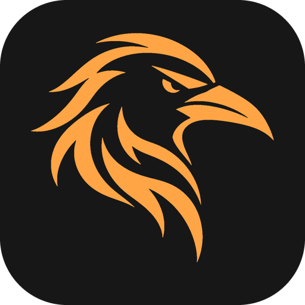
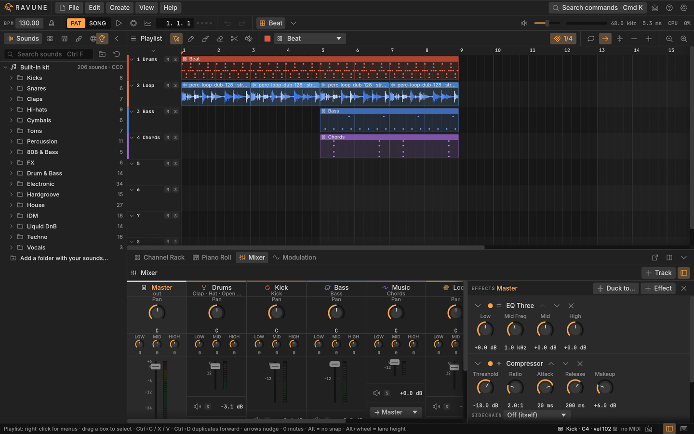
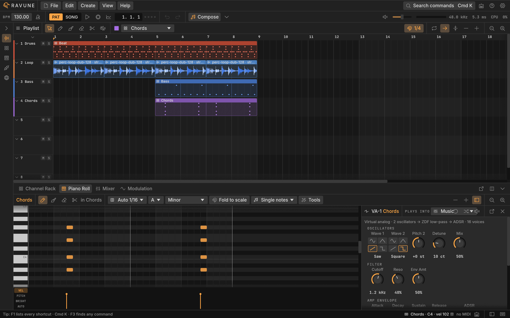
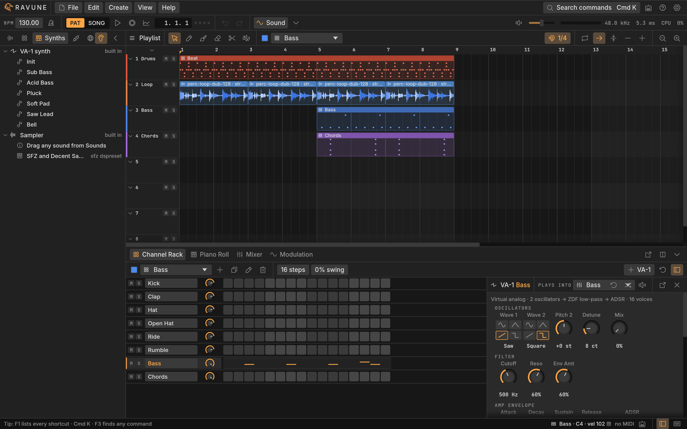
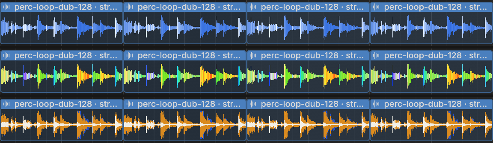

<div align="center">



<h1>Ravune</h1>

<p><b>A lightweight, modular DAW built with Rust.</b></p>

<p>
<a href="https://github.com/g1lg1l/ravune/releases"><b>Download the beta</b></a> ·
<a href="https://g1lg1l.github.io/ravune/"><b>Documentation</b></a> ·
<a href="docs/PLAN.md">Roadmap</a>
</p>

<p>


<a href="https://g1lg1l.github.io/ravune/"></a>
<br>


</p>

<p>
<a href="https://ko-fi.com/g1lg1l"></a>
</p>



</div>

Approachable on day one, deep enough for a lifetime. Free and open source, forever: no tiers, no track limits. AI stays optional, local-first and off by default.

## Features

- **Make**: a channel rack and a piano roll, two views of the same notes. Chords, per-note pitch and brightness, MPE. A sampler with attack and release, SFZ and Decent Sampler instruments, the VA-1 synth.
- **Arrange**: a playlist where any clip goes on any lane. Automation clips from any knob, drawn or recorded; clip envelopes; loops that follow the tempo; markers; a song built from your patterns.
- **Mix**: sends, buses and cables, 8 built-in effects, one-click sidechain, macros with Rand and variations, LFOs, MIDI learn.
- **Plug in**: CLAP and VST3, each in its own process. A crashing plugin goes quiet, Ravune carries on.
- **Find**: a CC0 library with packs for House, Techno, Hardgroove, Drum & Bass, Liquid DnB, IDM and Electronic; your own folders; free sounds online, with their credits kept for you.
- **Start fast**: seven genre templates, interactive lessons, the manual inside the app, DAWproject to and from other DAWs.
- **Script it, talk to it**: Luau scripts, and an MCP server so Claude or any agent can build, listen and undo in one step.
- **See it**: waveforms in three styles, mono, RGB by frequency, or low, mid and high in layers like a CDJ.
- **Make it yours**: themes, keymaps, workspaces, extensions, English and Italian.
- **Under the hood**: every edit is an undoable operator; a lock-free, allocation-free engine; plain-text `.ravune` projects, autosaved.

<table>
<tr>
<td width="50%"></td>
<td width="50%"></td>
</tr>
<tr>
<td align="center"><sub>Piano roll: tools, scale, chords, velocity / pitch / brightness lane</sub></td>
<td align="center"><sub>Channel rack and device: steps, and the selected channel's synth</sub></td>
</tr>
</table>

<p align="center">
<br>
<sub>One loop, three waveform styles (Preferences → Look): mono, RGB, 3-band</sub>
</p>

## Get it

[Releases](https://github.com/g1lg1l/ravune/releases) has the 0.9.1 beta: an installer for Windows, a disk image for macOS (Apple Silicon) and a tarball for Linux. They aren't signed yet: on Windows, SmartScreen's More info → Run anyway; on macOS, right-click Ravune → Open the first time.

Or build it with [Rust](https://rustup.rs) (stable); on Windows the MSVC toolchain, on Linux `libasound2-dev`.

```bash
git clone https://github.com/g1lg1l/ravune
cd ravune
cargo run --release -p ravune
```

File → New from Template gives you a song to start from: `Space` plays it, `F9` opens the mixer. Keep `ravune-host` (plugins) and `ravune-mcp` (agents) next to the program. Developed on Windows 11; macOS and Linux pass the tests in CI but haven't been tried by hand. More in [Install and run](https://g1lg1l.github.io/ravune/install.html).

## Current state

Ravune is in beta. You can already make a whole track in it: beats, melodies, arrangement, mixing, your plugins, scripts and agents, and it updates itself. It's made and used daily on Windows; macOS and Linux build and pass the tests, but have seen little real use. Next up are smart helpers (splitting drums from tones, audio to notes) and polish on the way to 1.0. Expect rough edges, and tell us about them in [Issues](https://github.com/g1lg1l/ravune/issues).

The plan is in [docs/PLAN.md](docs/PLAN.md), what's still open in [docs/AUDIT.md](docs/AUDIT.md).

## Support

Ravune is free and always will be. If it's useful to you, [a coffee on Ko-fi](https://ko-fi.com/g1lg1l) buys time for what comes next.

## License

Dual-licensed under [MIT](LICENSE-MIT) or [Apache-2.0](LICENSE-APACHE), at your option. The built-in sounds are CC0 ([credits](assets/library/LICENSE.txt)).
